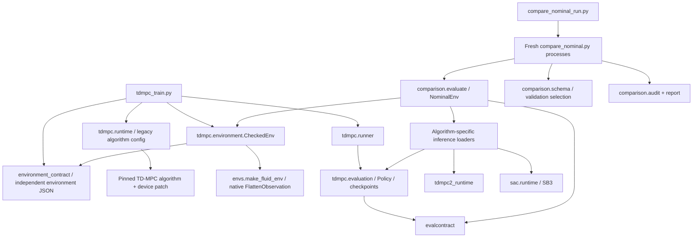

# Dependency map — 2026-10-14

Paths are repository-relative. This includes subprocesses, shell orchestration,
public documented CLIs and patched/dynamic imports, not just Python importers.
Prior KEEP decisions in `SCRIPT_INVENTORY.md` and `DIAGNOSTIC_CLEANUP.md` stand.

## Algorithm and evaluation paths

TD-MPC2 training is `tdmpc2_train_full.py -> pilot -> make_tdmpc2_workcopy ->
logging patch -> tdmpc2_pilot_worker.py -> Hydra/common.parser -> upstream
OnlineTrainer/TDMPC2/Buffer/Logger`. The patched upstream `envs.make_env` dynamically
imports `fluidgym_rl.tdmpc2_adapter.make_env`, then wraps it in `TensorWrapper`.
The worker Observer wraps calls for counters and logging; it does not replace the
learning objective. Hydra composition changes cwd and owns generic `common`/`envs`
module names, which is why fresh-process isolation matters.

SAC training is `sac_train.py -> sac.runtime -> SB3.SAC -> SACEnv -> NominalEnv ->
CheckedEnv -> native FluidGym`. `NominalCallback` observes gradients and delegates
validation to `comparison.evaluate`. This remaining SAC-to-comparison-to-TD-MPC
adapter dependency is a future merge/extraction candidate, not evidence of shared
algorithms. No algorithm implementation imports the physical environment contract.

## Every CLI and artifact contract

E0 = `envs.make_fluid_env` (native flattening); E1 = E0 + CheckedEnv;
E2 = E0 + TD-MPC2 adapter + upstream TensorWrapper; E3 = E1 + NominalEnv reward check.
A dash means the CLI does not perform that responsibility.

| Entry point in scripts/ | Algorithm/environment | Evaluator/checkpoint loader | Output schema / active caller |
|---|---|---|---|
| `tdmpc_train.py` | Pinned original TDMPC; E1 | tdmpc.evaluation Policy/evaluate/load_checkpoint; fresh child verify | resolved_config.yaml, run_manifest.json, train.csv, eval.csv, summary.json, best/latest/final.pt + JSON; README/TD_MPC_NOMINAL |
| `tdmpc2_train_full.py` | Launches worker; E2 | worker/upstream; no validation selection | launch.json, stdout/stderr, status.json, exit_code.txt; REMOTE_EXECUTION |
| `tdmpc2_pilot_worker.py` | Upstream TDMPC2/OnlineTrainer/Buffer; E2 | upstream trainer.eval on train split; agent.save | metrics.jsonl, upstream/models/*.pt + run_config.json, evaluation.json; parent subprocess |
| `sac_train.py` | SB3 SAC; SACEnv/E3 | sac.runtime.load_checkpoint, callback/common evaluation; fresh child verify | manifest/config, train.csv, val.csv, diagnostics.jsonl, summary, zip + sidecar; SAC_NOMINAL |
| `compare_nominal.py` | TD-MPC, TD-MPC2, SAC or zero policy; E3 | comparison.evaluate.load_policy delegates each native loader | episodes.csv, summary.json, resolved_config.yaml, evaluation_manifest.json; select JSON; CSV/Parquet/dashboard/figures |
| `compare_nominal_run.py` | All three; child E3 | fresh subprocess per checkpoint/split; comparison.schema.select_best | validation candidates, selection.json, best/final test, suite_manifest.json |
| `evaluate_checkpoint.py` | TD-MPC2 or SAC; E0 | tdmpc2_runtime.load_agent / SB3.load; run_eval | legacy episodes/summary/run_manifest; remote_milestone and remote docs |
| `evaluate_official_sac.py` | Public SB3 SAC; E0 | official_sac inspect/validate + SB3Policy; run_eval | legacy episodes/summary/run_manifest/public comparison; milestone |
| `audit_sac_checkpoint.py` | Public SAC inspection; no simulation | zip metadata/space inspection, optional SB3 load | checkpoint audit JSON; SAC docs/tests |
| `tdmpc2_smoke_train.py` | Upstream TD-MPC2; E2 | tdmpc2_checks, load_agent, fresh child verifier | report.json/metrics/checkpoint/reference/run_config; remote smoke/milestone |
| `tdmpc2_ckpt_verify.py` | New TD-MPC2 model; no simulator | load_agent; digest/actor/seeded-plan probes | stdout JSON and exit status; smoke subprocess |
| `integration_cuda.py` | TD-MPC2 factory adapter; E2 | factory/device/boundary tests; no checkpoint | Report schema; remote_smoke |
| `phase0_validate.py` | FluidGym; E0 | simulator/seed/device/render tests | phase0 report, visual artifacts, gate evidence; remote workflows |
| `check_phase0_status.py` | — | status.phase0_status | status JSON, exits 0/4/1; milestone/official SAC |
| `mark_gate.py` | — | safety.write_gate | evidence path/hash gate JSON; documented explicit gate workflow |
| `consolidate_milestone.py` | — | consumes stage reports and legacy eval | MILESTONE_REPORT.md; remote_milestone |
| `summarize_remote.py` | — | consumes smoke stage reports | SUMMARY.md/summary.json; remote_smoke |
| `package_tdmpc_results.py` | — | no loading | metadata-only tar.gz, excludes model binaries; TD-MPC docs |
| `package_sac_results.py` | — | verify_result for supplied evals | full archive plus PACKAGE_MANIFEST hashes; SAC docs |
| `fetch_upstream.sh` | Pinned lock entries | git clone/fetch/checkout | third_party clones; remote_setup; TD-MPC opt-in |
| `remote_setup.sh` | Dependency installation | lock/workflow setup | setup logs/freeze/constraints; README; not executed in audit |
| `remote_smoke.sh` | phase0 -> integration -> TD-MPC2 smoke | children + summarize_remote | stage logs/return codes/reports; README |
| `remote_milestone.sh` | phase0 -> official SAC -> TD-MPC2 smoke | checkpoint plan/actor eval -> consolidation | stage logs + milestone report; README |

The worker and both report aggregators are positional internal CLIs, not argparse
`--help` interfaces. Tests execute their supported synthetic/subprocess paths.
The shell launchers are not safe dry-run commands: some install or run simulation.
Only shell syntax was checked in this audit.

## Output and protocol boundaries

- TD-MPC native checkpoints: online/target weights plus JSON parameter/probe/std/hash
  sidecar. Restoration is inference-only. Rolling periodic history is incomplete.
- TD-MPC2: model weights plus adjacent `run_config.json`; periodic and final files;
  generic upstream namespace isolated per process. No optimizer/RNG resume.
- SAC: SB3 zip plus version/physics/probe/hash sidecar; no complete experiment resume.
- Historical TD-MPC validation uses `official_callback`, seed=train_seed+10000;
  TD-MPC2 `eval/*` remains train split. Shared evaluation uses `seeded` and explicit
  train/val/test. Those historical log values remain incompatible comparison rows.
- Shared comparison uses real environment steps from recorded sidecars/log evidence;
  physics/protocol cohort hashes, validation-only selection, frozen best/final test
  roles and per-result hashes prevent silent merging. Losses stay algorithm-specific.

## Internal import inventory

The accompanying `refactor_evidence/source_inventory.json` records each production,
script and test file's imports, top-level symbols and SHA-256. Imports are collected
inside functions as well as at module scope. Dynamic edges above supplement that
inventory. Module classifications and deferred duplication are in `REFACTOR_AUDIT.md`.
